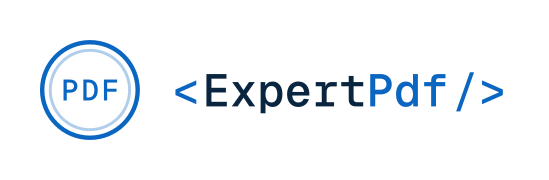

  <a href="https://www.html-to-pdf.net/">
    <picture>
      <source media="(prefers-color-scheme: dark)" srcset="images/expertpdf-logo-dark.svg">
      
    </picture>
  </a>

  HTML to PDF converter and PDF libraries for .NET since 2007.

## Products

- **[ExpertPdf Anywhere](https://www.html-to-pdf.net/expertpdf-anywhere/)** - every ExpertPdf tool in one .NET library
  for Windows, Linux and macOS: HTML, Word and RTF to PDF, PDF creation, merge, split, security, PDF to text and image.
- **[HTML to PDF Converter](https://www.html-to-pdf.net/html-to-pdf-converter/)** - web pages, HTML files and HTML
  strings to PDF in .NET, with the Chromium, Blink and WebKit engines.
- **[PDF components](https://www.html-to-pdf.net/pdf-library/)** - PDF Creator, PDF to Text, PDF to Image, PDF Merge,
  PDF Split, PDF Security, PDF Viewer, RTF to PDF, PDF Images Extractor, and the ExpertXLS Excel library.

## Repositories

- [anywhere-samples](https://github.com/expertpdf-components/anywhere-samples) - samples for ExpertPdf Anywhere:
  console, web, Docker, cloud and Azure Functions, for Windows, Linux and macOS.
- [ai-tools](https://github.com/expertpdf-components/ai-tools) - skills that teach AI coding assistants to use
  ExpertPdf Anywhere.
- [expertpdf-engine](https://github.com/expertpdf-components/expertpdf-engine) - the ExpertPdf Anywhere remote
  engine container image, `ghcr.io/expertpdf-components/engine`.

## Resources

- Documentation: [ExpertPdf Anywhere](https://docs.html-to-pdf.net/anywhere-library/html/Index.htm) - every product
  page links its own documentation.
- Online samples: [ExpertPdf Anywhere](https://samples.html-to-pdf.net/anywhere/),
  [HTML to PDF](https://samples.html-to-pdf.net/html-to-pdf/), [PDF Creator](https://samples.html-to-pdf.net/pdf-creator/),
  [PDF Viewer](https://samples.html-to-pdf.net/pdf-viewer/), [ExpertXLS](https://samples.html-to-pdf.net/excel-cs/)
- NuGet: [nuget.org/profiles/expertpdf](https://www.nuget.org/profiles/expertpdf)
- Downloads: [html-to-pdf.net/downloads](https://www.html-to-pdf.net/downloads/)
- Support: office@html-to-pdf.net

ExpertPdf is a product of Outside Software SRL, Bucharest, Romania.
